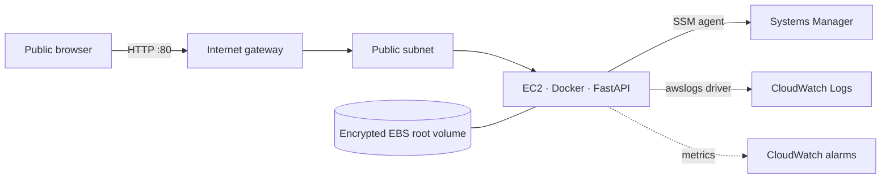

# Public SrotaAI demo on AWS EC2

This Terraform stack creates a dedicated VPC, public subnet, internet gateway,
security group, Amazon Linux 2023 EC2 instance, IAM instance profile, and
CloudWatch resources. EC2 installs Docker, builds the app from the public
GitHub `main` branch, and serves the seeded dashboard over HTTP on port 80.
It is intentionally a **read-only portfolio demo**: project mutations are
rejected and the background ingestion scheduler is disabled. Do not put
patient records, credentials, or other private data in this demo.



The security group exposes only HTTP. It has no inbound SSH rule. The instance
role grants AWS-managed `AmazonSSMManagedInstanceCore` for Session Manager and
scoped write access to this app's CloudWatch log group. Session Manager works
when your AWS identity has the matching permissions. Container logs are kept
for seven days; CPU and EC2 status-check alarms appear in the console without
sending email.

The trained local model files and CADEC-derived training data are intentionally
Git/Docker-ignored. This public deployment therefore runs the repository's
default rules path; it does not load the local ADE/CRF artifacts. Do not put
private training data into the public image. Add a reviewed, licensed model
artifact delivery path separately if the hosted demo must show learned scores.

## Before you launch

- An AWS account with billing enabled and permissions to manage EC2, VPC
  networking, security groups, IAM roles/instance profiles, CloudWatch, and SSM.
- AWS CLI credentials configured for the account you intend to use.
- Terraform 1.6+ installed.

This creates billable resources. EC2 compute, the 20 GB encrypted EBS root
volume, data transfer, public IPv4 usage, CloudWatch logs, and alarms can incur charges. AWS currently
lists in-use public IPv4 at **$0.005 per hour**; check [current VPC pricing](https://aws.amazon.com/vpc/pricing/)
and the [EC2 pricing page](https://aws.amazon.com/ec2/pricing/on-demand/)
for your region and account before applying. Set an AWS billing budget/alarm.
There is no automatic shutdown.

## Deploy

Run these commands from this directory. Review the plan carefully; `apply`
creates the public instance.

```bash
aws sts get-caller-identity
cp terraform.tfvars.example terraform.tfvars
terraform init
terraform fmt -check
terraform validate
terraform plan
terraform apply
terraform output -raw dashboard_url
```

Open the output URL after the instance finishes booting and building the
container. The app uses the included seed database. A Docker named volume
keeps SQLite data across container restarts; replacing or destroying the EC2
instance removes that local volume and restores from the image's seed DB.

The URL is plain HTTP on a changing EC2 public hostname. This is suitable for
a read-only portfolio demo. Do not submit credentials or sensitive data. A
custom domain and HTTPS require additional DNS/TLS infrastructure.

## Troubleshoot

1. In the EC2 console, wait until both instance checks pass.
2. Select **Connect → Session Manager**. If the instance is not online, verify
   that the account has Session Manager permissions and that the instance can
   reach AWS SSM endpoints.
3. Inspect boot logs with `sudo tail -200 /var/log/srotaai-bootstrap.log` and
   app logs with `sudo docker logs srotaai`.
4. From the instance, check `sudo docker ps` and
   `curl -i http://127.0.0.1/healthz`.

Amazon Linux 2023 images generally include SSM Agent; the instance profile
policy is required for Session Manager access. See [AWS SSM Agent AMI guidance](https://docs.aws.amazon.com/systems-manager/latest/userguide/ami-preinstalled-agent.html)
and [EC2 Session Manager requirements](https://docs.aws.amazon.com/AWSEC2/latest/UserGuide/connect-with-systems-manager-session-manager.html).

## Update the demo

Push the reviewed code to the configured public Git branch, then replace the
instance so bootstrap clones the new revision:

```bash
terraform apply -replace=aws_instance.srotaai
```

This causes downtime and the public hostname changes. Review Terraform's plan
before confirming.

## Remove all resources

When you finish experimenting, remove the infrastructure:

```bash
terraform destroy
```

Confirm in the EC2 console that the instance and security group are gone. The
root EBS disk is configured to be deleted with the instance. Keep the
Terraform state file private; it contains resource metadata.
